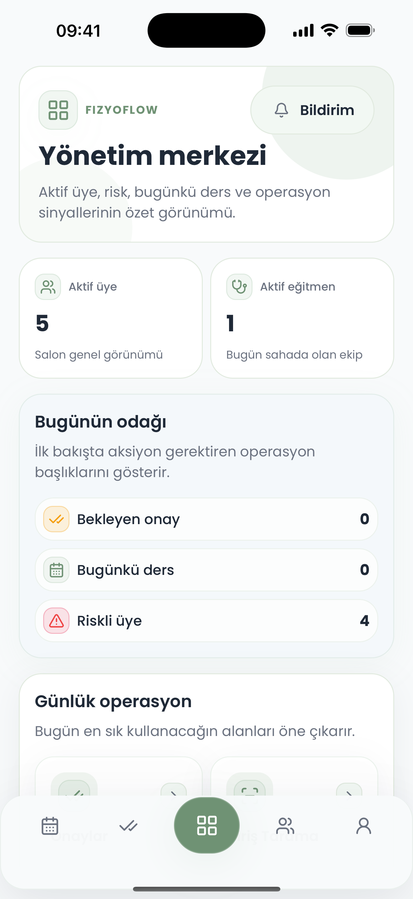
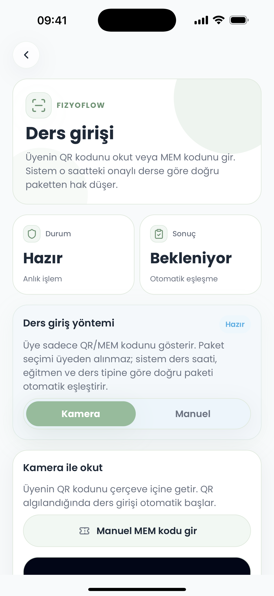
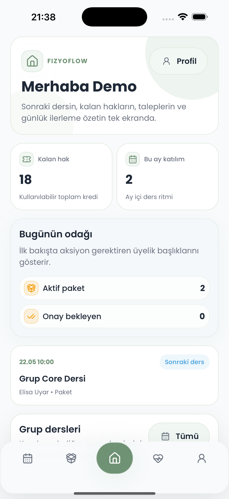
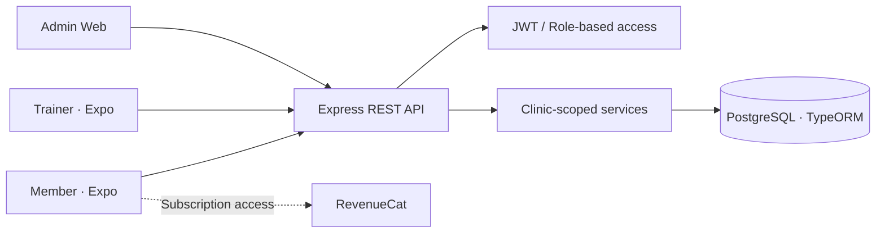

# FizyoFlow

**Clinic management SaaS for physiotherapy and pilates studios.**

FizyoFlow brings together scheduling, class/package tracking, trainer workflows, member access and subscriptions in a mobile-first product. The iOS application has been published on the App Store.

**Website:** https://fizyoflow.com

## What it does

- **Admins:** manage clinics, schedules, trainers, members and operational workflows.
- **Trainers:** manage recurring/special sessions, attendance and class calendars.
- **Members:** access upcoming bookings, remaining package credits and QR-based check-in.
- **Subscriptions:** integration with RevenueCat for mobile subscription entitlements.
- **Tenant-aware access:** role-based workflows and clinic-scoped application data.

## Product preview

Selected interface captures from the public product-tour assets. These are illustrative screenshots, not a claim of active customer usage.

| Admin dashboard | Trainer check-in | Member overview |
| --- | --- | --- |
|  |  |  |

## Architecture

The repository is a pnpm/Turborepo monorepo:

```text
apps/
  api/          Express.js backend and REST API
  admin-web/    Administration web client
  web/          Public-facing web application
  mobile/       React Native / Expo mobile application
packages/
  contracts/    Shared API contracts
  shared-types/ Shared types
  eslint-config/
  tsconfig/
```




This is a high-level overview, not a complete production deployment or security diagram.

## Technology

**Backend:** Node.js, Express.js, PostgreSQL, TypeORM, JWT  
**Web & mobile:** React Native, Expo, React/Next.js  
**Tooling:** TypeScript, pnpm, Turborepo, Docker, Vitest, Playwright, Maestro  
**Subscriptions:** RevenueCat

## Running locally

> This is a multi-app project. Depending on the service, development requires a PostgreSQL instance and correctly configured environment variables. Never commit real credentials.

Prerequisites: Node.js, pnpm, Docker (for local infrastructure), and platform-specific development tools for mobile.

```bash
pnpm install
cp .env.example .env
```

Review `.env.example` and the relevant app-specific configuration before starting services.

Useful workspace commands:

```bash
pnpm dev:api        # API
pnpm dev:admin      # Admin web
pnpm dev:web        # Web
pnpm dev:mobile     # Expo
```

## Testing and quality

```bash
pnpm test
pnpm typecheck
pnpm lint
```

There are separate end-to-end workflows for web and mobile. Their execution requires the corresponding browser, simulator or device setup.

- [Test guide](TESTING.md)
- [Mobile test inventory](docs/maestro-test-inventory.md)
- [Release gates](docs/release-gate.md)

## Deployment and operations

- [VDS / Docker deployment guide](docs/vds-docker-deploy.md)
- [Web production launch](docs/web-production-launch.md)
- [RevenueCat setup](docs/revenuecat-setup.md)

**Note:** This public repository is shared to demonstrate engineering work. It is not an invitation to use production secrets or connect to live clinic data. Verify environment-specific configuration, migration steps and security settings before operating a deployment.

## Engineering focus

- Tenant-scoped SaaS workflows and role-based authorization
- Mobile-to-backend integration and shared contracts
- Scheduled and recurring session management
- Automated regression testing and release verification
- App Store distribution and subscription integration

For a concise overview of the product, visit **https://fizyoflow.com**.
